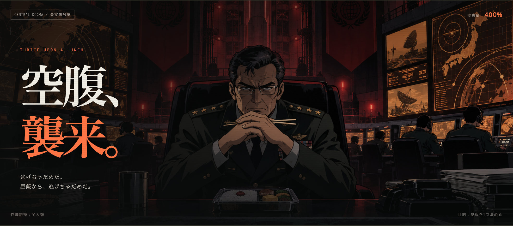

# シン・ランチゲリオン

<sup>THRICE UPON A LUNCH</sup>

**昼食補完スロット**



昼飯を決めるだけなのに、人類の命運を託される

警報、次回予告、激アツ、絶望、そして復活  
エヴァ風の演出を詰め込んだ、無駄に壮大なランチ抽選スロットです

> 「必ず、帰ってくる」  
> 「……13時には」

## 🚀 起動

Node.js 18以上で動きます  
依存パッケージのインストールは不要です

```sh
npm start
```

ブラウザで **http://localhost:4173** を開いてください

## 🎰 遊び方

### 1. 出撃候補を選ぶ

料理をタップすると、抽選への参加・除外を切り替えられます  
気分じゃない候補は、出撃前に外しておきましょう

**「編集」** から、好きな料理や近所のお店を候補にできます  
1行に1つ入力してください

候補は **最大16個・各20文字まで**  
最後の1候補は残ります。人類の昼飯を奪わないでください

### 2. 「作戦開始」を押す

箸を握り、家族に別れを告げ、昼飯へ出撃します

| 演出 | 司令部で起きること |
| --- | --- |
| 🚨 **警報** | 空腹警報、発令。これは訓練ではない。普通の昼休みだ |
| 👋 **出撃** | 家族が号泣。帰還予定は13時 |
| 🎬 **次回予告** | 「見知らぬ、天丼」「せめて、昼飯らしく」 |
| 🔥 **激アツ** | 金文字です。昼飯しか当たりません |
| 😱 **絶望** | 定休日、売り切れ、待ち時間90分…… |
| ✨ **復活** | 「まだだ。フードコートがある」 |
| 👊 **PUSH** | 押せ。食べろ。午後の会議に戻れ |

### 3. 昼飯を受け入れる

**PUSH** を押すと、3つのリールが揃って昼飯が確定します  
押さなくても、カウントダウン後に司令部が勝手に押します

> 世界を救った。並盛で。

なお、お会計はあなたです

### ⚙️ 司令部の便利な機能

| 操作 | できること |
| --- | --- |
| **演出：壮大 ⇄ 爆速** | 壮大は約25秒、爆速は約8秒。急ぐ日は司令部の長話を短縮 |
| **音響 ON / OFF** | 警報や電子効果音を切り替え。初期設定はOFF |
| **演出を飛ばす** | 抽選済みの昼飯をすぐに表示 |
| **運命をやり直す** | 新しい昼飯を抽選。家族との別れからやり直し |

候補・除外状態・前回の結果は、ブラウザ内に保存されます  
保存できない環境でも、そのまま遊べます

すべての参加候補は、同じ確率で選ばれます  
金文字、PUSHのタイミング、演出スキップで結果は変わりません

定休日や売り切れの表示は、架空の演出です  
実際のお店の営業状況とは関係ありません

## 🧪 開発用チェック

```sh
npm run check
npm test
```
